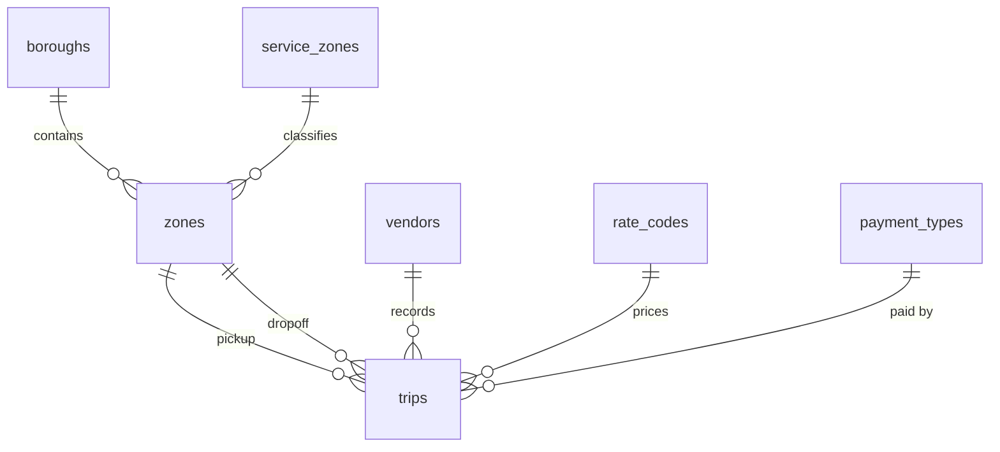

# Schema Design

## Tables
| Table | One row is... | Primary key | Foreign keys |
|---|---|---|---|
| boroughs | a borough name | borough_id | none |
| service_zones | a service zone name | service_zone_id | none |
| zones | one of the 265 taxi zones | location_id | borough_id, service_zone_id |
| vendors | a taxi technology vendor | vendor_id | none |
| rate_codes | a rate code | rate_code_id | none |
| payment_types | a payment type | payment_type_id | none |
| trips | one cleaned trip | trip_id | vendor_id, pickup_location_id, dropoff_location_id, rate_code_id, payment_type_id |

## ER diagram

## Integrity plan
| Rule | Where |
|---|---|
| Primary key | every table |
| Foreign keys (delete restricted) | trips to zones (pickup and dropoff), vendors, rate_codes, payment_types; zones to boroughs, service_zones |
| NOT NULL | every trip column except store_and_fwd_flag |
| Time order | dropoff after pickup |
| Ranges | distance 0 to 100, fare 0 to 500, total 0 to 1000 and not below fare, tip 0 to 500, tolls not negative, passengers 1 to 6, duration 1 to 180 |
| Flag values | store_and_fwd_flag is Y, N or NULL |
| Real text values | 'Unknown' and 'N/A' boroughs are stored as rows, not NULL |

## Indexing plan (database/indexes.sql)
| Index | Dashboard use |
|---|---|
| trips (pickup_datetime) | time filters, hourly and daily charts |
| trips (pickup_location_id, pickup_datetime) | zone plus time |
| trips (trip_distance) | distance filter and sort |
| trips (total_amount) | fare filter and sort |

Foreign key columns are indexed automatically by InnoDB.

